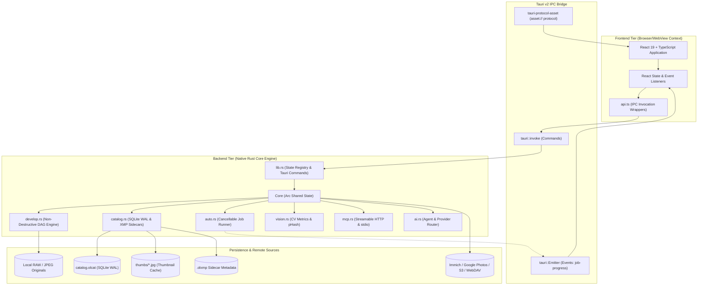

# Chapter 2: System Architecture & Dual-Mode Runtime

This chapter details the high-level architecture of OpenLight Studio, its execution modes, the IPC bridge between the frontend and backend, state ownership, and its concurrency model.

---

## 1. High-Level Architectural Flow

OpenLight Studio separates user interface presentation, native system integration, and raw image processing into clean, isolated tiers:



---

## 2. Multi-Mode Application Runtime

OpenLight Studio is packaged as a single native binary that adapts its execution path depending on command-line arguments:

### Mode A: Full Desktop GUI Application (`openlight-studio`)
* Default launch mode when launched from Finder, application menus, or CLI without arguments.
* Initializes Tauri v2 desktop shell, creates the native application window (1280x800 default), registers system menus, and mounts the React 19 UI.
* Starts the in-process **Streamable HTTP MCP Server** on loopback `http://127.0.0.1:41920/mcp` with bearer authentication.
* Serves the `asset://` custom protocol to stream thumbnails and local photos securely into the WebView without CORS restrictions.

### Mode B: Headless CLI Folder Importer (`openlight-studio --import <folder>`)
* Executes without initializing GUI windows or WebViews.
* Recursively scans `<folder>` for supported RAW and bitmap formats (DNG, CR2, CR3, NEF, ARW, RAF, RW2, ORF, PEF, JPEG, TIFF, PNG, AVIF, HEIC).
* Extracts EXIF metadata, creates `.olcat` records, and generates cached thumbnails under `thumbs/`.
* Exits immediately upon completion with status code `0`, ideal for automated ingestion scripts and ingest hooks.

### Mode C: Headless or Forwarded MCP Stdio Server (`openlight-studio --mcp-stdio`)
* Provides a standard Model Context Protocol interface over `stdin` / `stdout`.
* **Smart Forwarding**:
  1. Checks if a GUI instance of OpenLight Studio is currently running on `http://127.0.0.1:41920`.
  2. If running, forwards incoming JSON-RPC 2.0 messages directly to the active GUI app over HTTP, updating the user's open Develop canvas in real-time.
  3. If no GUI app is running, initializes a headless `Core` instance against `<OPENLIGHT_DATA_DIR>/catalog.olcat` and performs catalog edits and exports in headless mode.

---

## 3. Tauri IPC & Communication Architecture

### 3.1 Command Invocation (`invoke`)
The frontend communicates with Rust through typed wrapper functions declared in [`src/api.ts`](file:///Volumes/RIT-2TB/ws/56%20Desktop%20App/openlight_studio/src/api.ts). Each function wraps `@tauri-apps/api/core::invoke`:

```typescript
// Frontend (src/api.ts)
export async function loadDevelop(photoId: number): Promise<DevelopResponse> {
  return invoke("load_develop", { photoId });
}

export async function saveDevelop(photoId: number, develop: Develop): Promise<void> {
  return invoke("save_develop", { photoId, develop });
}
```

On the Rust backend, commands are defined as async/sync functions registered in the `tauri::Builder` invoke handler in [`src-tauri/src/lib.rs`](file:///Volumes/RIT-2TB/ws/56%20Desktop%20App/openlight_studio/src-tauri/src/lib.rs):

```rust
// Backend (src-tauri/src/lib.rs)
#[tauri::command]
fn load_develop(state: tauri::State<'_, Arc<Core>>, photo_id: i64) -> Result<DevelopResponse, String> {
    state.load_develop(photo_id)
}
```

### 3.2 Real-Time Event Streaming (`emit` / `listen`)
Long-running asynchronous jobs (such as the 6 Auto functions in `auto.rs` or cloud downloads in `remote.rs`) do not block IPC commands. Instead, they stream progress events through `tauri::Emitter`:

* **`job-progress`**: Emitted during auto culling, AI masking, batch editing, and duplicate scans.
  ```typescript
  export type JobProgress = {
    function: string;      // "cull" | "edit" | "mask" | "enhance" | "blur" | "duplicates"
    done: number;
    total: number;
    current_photo?: string;
    summary?: any;
  };
  ```
* **`folder-progress`**: Emitted during large directory ingestion and cloud folder downloads.
* **`catalog-changed`**: Emitted when external operations (e.g. MCP tool mutations) modify ratings or settings, instructing the UI to refresh without a full reload.

### 3.3 The Asset Streaming Protocol
To display multi-gigabyte RAW image files and hundreds of cached thumbnails smoothly without base64 serialization overhead, OpenLight Studio leverages Tauri's custom asset protocol:

```typescript
import { convertFileSrc } from "@tauri-apps/api/core";

// Converts local file path: /Users/name/photos/IMG_0001.CR3
// Into custom protocol URL: asset://localhost/Users/name/photos/IMG_0001.CR3
const imgSrc = convertFileSrc(photo.path);
```

---

## 4. State Ownership & Concurrency Model

### 4.1 The Central `Core` Struct
The entire backend engine state is consolidated inside the `Core` struct, managed as an `Arc<Core>` inside Tauri's managed state:

```rust
pub struct Core {
    pub dir: PathBuf,                     // Root OPENLIGHT_DATA_DIR
    pub db: Mutex<rusqlite::Connection>,  // SQLite connection with WAL mode
    pub settings: Mutex<Settings>,        // App settings, active providers, cloud accounts
    pub cancel_tokens: Mutex<HashMap<String, Arc<AtomicBool>>>, // Cancellable auto jobs
    pub proxy_cache: Mutex<LruCache<PathBuf, Arc>>,        // In-memory 1600px develop proxies
}
```

### 4.2 SQLite Concurrency via WAL Mode
The database connection initiates with Write-Ahead Logging:
```sql
PRAGMA journal_mode=WAL;
PRAGMA foreign_keys=ON;
PRAGMA busy_timeout=5000;
```
* **Read-Write Separation**: Multiple read transactions can execute concurrently with a single write transaction without table locks.
* **Crash Resilience**: Atomic commits guarantee that unexpected process termination leaves `.olcat` in a consistent state.

### 4.3 Rayon Parallelism for Pixel Processing
Tonal math, 3D Point Color lookup, bilateral filtering, and image encoding are computationally heavy. OpenLight Studio avoids blocking the main event loop by using **Rayon** for data-parallel iteration:

```rust
// Parallel pixel processing across CPU cores
px.par_iter_mut().for_each(|p| {
    *p = tone.apply(*p);
});
```

Long-running jobs spawned in `auto.rs` run on dedicated background threads, checking their designated `AtomicBool` cancellation token on each iteration to permit instantaneous user cancellation.

