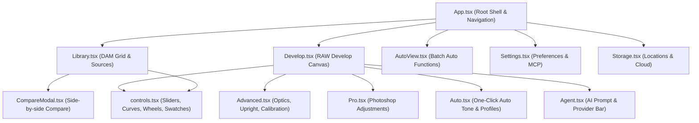

# Chapter 3: Frontend Architecture & UI Guidelines

This chapter documents the frontend architecture of OpenLight Studio: technology choices, component decomposition, custom UI controls, state management, 60fps rendering guidelines, and keyboard shortcuts.

---

## 1. Technology Stack & Directory Structure

The frontend lives in [`src/`](../src/) and is built with:
* **React 19 (`react` & `react-dom` ^19.1.0)**: Modern concurrent React rendering.
* **TypeScript (~6.0.3)**: Strict typing enabled across all components, API schemas, and state objects.
* **Tailwind CSS v4 (`@tailwindcss/vite` ^4.3.3)**: Modern utility-first CSS engine with dark mode theming and sub-millisecond compilation.
* **Vite (^8.0.16)**: Lightning-fast development server with Hot Module Replacement (HMR) and optimized ESModule bundling.
* **Tauri API v2 (`@tauri-apps/api` & `@tauri-apps/plugin-dialog`)**: Native window management, file pickers, and IPC communication.

---

## 2. Component Hierarchy & Module Decomposition



### 2.1 [`App.tsx`](../src/App.tsx) — Application Shell & Root State
* **Active View State**: Manages top-level navigation: `"library"`, `"develop"`, `"auto"`, `"settings"`, `"storage"`.
* **Selection State**: Tracks the currently active `selectedId: number | null` and multi-selection array `selectedIds: number[]`.
* **Global Hotkey Dispatcher**: Centralizes window-level keyboard event listeners (switching modules, flag toggles, star ratings, undo/redo).
* **Toast & Notification System**: Surfaces non-blocking notification banners for background jobs, cloud sync progress, and MCP tool executions.

### 2.2 [`Library.tsx`](../src/Library.tsx) — Digital Asset Management (DAM)
* **Sources Sidebar**:
  * Local folders (added via native directory picker).
  * Network shares (SMB/NFS/WebDAV with connection health indicators).
  * Immich albums and favorites.
  * Google Photos picked collections.
  * Cloud accounts (S3, Dropbox, OneDrive, WebDAV).
  * System Bin / Trash view for deleted photos.
* **Filter Bar**: Dynamic filtering by search text, star ratings (0–5), flags (Pick, Unflagged, Reject), color labels (Red, Yellow, Green, Blue, Purple), aspect ratio, virtual copy types, and edited status.
* **Thumbnail Grid**: Renders thumbnail cards via the `asset://` protocol with rating stars, flag badges, and thumbnail generation indicators.

### 2.3 [`Develop.tsx`](../src/Develop.tsx) — RAW Image Editor
* **Interactive Canvas**: Renders the 1600px proxy viewport rendered by Rust.
* **Live RGB/Luminance Histogram**: Displays real-time 256-bin histogram with clickable Shadow (`J`) and Highlight clipping overlays.
* **Panels & Sub-Tabs**:
  * **Adjust (Basic)**: White balance (Kelvin & Tint), Exposure, Contrast, Highlights, Shadows, Whites, Blacks, Texture, Clarity, Dehaze, Vibrance, Saturation.
  * **Tone Curve**: Parametric sliders (Highlights, Lights, Darks, Shadows) and RGB Point curve editor.
  * **Color Mixer**: 8-band HSL sliders (Red, Orange, Yellow, Green, Aqua, Blue, Purple, Magenta).
  * **Point Color**: 3D HSL swatch picker with interactive eyedropper, range sliders, and falloff control.
  * **Color Grading**: 3-way color wheels (Shadows, Midtones, Highlights) + Global wheel with blending and balance.
  * **Selections (Masks)**: Boolean mask layer list with Add, Subtract, Intersect, Invert, Feather, and Edge Shift controls.
* **Interactive Crop & Straightener**: On-canvas boundary handles, rotation dial, and rule-of-thirds grid.

### 2.4 [`Advanced.tsx`](../src/Advanced.tsx) — Optics, Geometry & Technical Tools
* **Lens Corrections**: Distortion slider, automatic and manual lateral chromatic aberration (Red/Cyan, Blue/Yellow), defringe controls (Purple/Green hue ranges), lens vignetting.
* **Transform (Upright)**: Automatic perspective correction modes (`Auto`, `Level`, `Vertical`, `Full`), Guided Upright with interactive line guides, manual keystone, and Constrain Crop.
* **Camera Calibration**: Shadow tint and primary Red, Green, and Blue Hue/Saturation calibration.
* **Detail & Grain**: Luminance and color noise reduction, film grain simulation (amount, size, roughness).
* **Soft Proofing**: Gamut warnings for sRGB, Display P3, and Adobe RGB color spaces.

### 2.5 [`Pro.tsx`](../src/Pro.tsx) — Photoshop-Grade Layer Adjustments
* **Levels**: Input Black, Gamma, Input White, Output Black, Output White for composite RGB and individual R, G, B channels with one-click Auto Levels.
* **Hue / Saturation**: Master Hue, Saturation, Lightness, and Colorize mode.
* **Selective Color**: CMYK channel shifts across Reds, Yellows, Greens, Cyans, Blues, Magentas, Whites, Neutrals, and Blacks.
* **Channel Mixer & Gradient Map**: Custom monochrome/RGB matrix mixing and dual-tone gradient mapping.
* **Filters & Rotation**: Gaussian blur, Invert, Posterize, Threshold, 90° rotations, and horizontal/vertical flips.

### 2.6 [`AutoView.tsx`](../src/AutoView.tsx) & [`Auto.tsx`](../src/Auto.tsx) — Auto Engine
* Dedicated dashboard for executing and tracking the 6 core autonomous functions:
  1. **Catalog & Culling** (sharpness, exposure, burst grouping, rating assignment).
  2. **Non-destructive Editing** (auto white balance, auto tone, style profiles).
  3. **AI Masking** (Subject, Sky, Background, People segmentation).
  4. **AI Denoise & Super Resolution** (wavelet denoise and 2x–4x upscaling).
  5. **Find Blurred Subjects** (motion blur and missed focus detection).
  6. **Find Duplicates** (SHA-256 and pHash duplicate grouping).

---

## 3. Custom UI Controls & Design System ([`controls.tsx`](../src/controls.tsx))

OpenLight Studio does not use heavy external component libraries. Instead, it features dedicated, high-performance photography controls:

| Control Component | Purpose | Interaction Details |
|---|---|---|
| `<Slider>` | Precision numeric parameter tuning | Double-click to reset to default; scrub left/right; manual text input for exact values. |
| `<CurveEditor>` | Tone curve modification | Bezier cubic spline rendering; draggable control points; channel selector (RGB, Red, Green, Blue). |
| `<ColorWheel>` | 3-way color grading | Polar coordinate picker ($r, \theta$); saturation ring; luminance slider; reset double-click. |
| `<PointColorSwatch>` | 3D HSL swatch editor | Visualizes sampled color in 3D color ellipsoid with interactive range limits. |
| `<Toggle>` / `<SegmentedControl>` | State switching | Accessible binary and multi-option switches with instantaneous feedback. |

---

## 4. 60fps Performance Guidelines

In professional photo applications, slider scrub lag makes tonal adjustment unworkable. Follow these rules when modifying or adding frontend features:

### Rule 1: Decouple Drag State from Backend IPC
* While a slider is being dragged, update the local React state and DOM immediately for smooth 60fps visual feedback.
* **Debounce** or throttle IPC calls to `saveDevelop` using `requestAnimationFrame` or a short timeout (e.g. 50ms) so the backend is not inundated with hundreds of full render requests per second.

```typescript
// Recommended pattern for high-frequency sliders
const [localValue, setLocalValue] = useState(initialValue);

const handleSliderChange = (newVal: number) => {
  setLocalValue(newVal); // Immediate DOM update
  debouncedSave({ ...develop, tone: { ...develop.tone, exposure: newVal } });
};
```

### Rule 2: Memoize Heavy Geometric & Curve Calculations
* Avoid recomputing spline control curves or color wheel polar-to-cartesian matrices inside the main component render loop. Wrap them in `useMemo`.

### Rule 3: Use SVG / Canvas for Complex Visualizers
* Curve graphs, histograms, and mask polygons must be rendered via SVG paths or `<canvas>` elements rather than deeply nested `div` trees to keep DOM node count low.

---

## 5. Keyboard Shortcut Reference

| Key / Shortcut | Scope | Action |
|---|---|---|
| `G` | Global | Switch to **Library (Grid)** view |
| `D` | Global | Switch to **Develop** view with selected photo |
| `E` | Global | Switch to **Develop (Loupe)** view |
| `0` – `5` | Library / Develop | Set star rating (0 = clear, 1–5 stars) |
| `P` | Library / Develop | Flag as **Pick** |
| `X` | Library / Develop | Flag as **Reject** |
| `U` | Library / Develop | Clear flag (**Unflagged**) |
| `6` – `9` | Library / Develop | Set color label (6=Red, 7=Yellow, 8=Green, 9=Blue) |
| `J` | Develop | Toggle **Clipping Warnings** (Red highlights, Blue shadows) |
| `\` | Develop | Toggle **Before / After** comparison |
| `C` | Library | Open **Compare View** modal |
| `Q` | Develop | Activate **Spot Removal (Heal)** tool |
| `S` | Develop | Activate **AI Object Selection** tool |
| `R` | Develop | Activate **Crop & Straighten** tool |
| `Cmd+Z` / `Ctrl+Z` | Develop | **Undo** last edit step |
| `Cmd+Shift+Z` / `Ctrl+Y` | Develop | **Redo** last edit step |
| `Cmd+Shift+E` / `Ctrl+Shift+E`| Global | Open **Batch Export** modal |
| `Esc` | Develop | Exit mask tuning / Cancel active tool |

