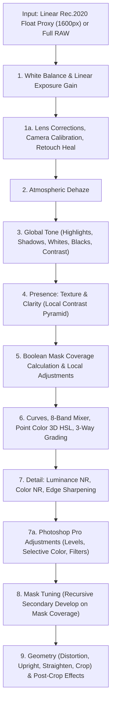

# Chapter 5: RAW Processing Pipeline, Color Science & Mathematics

This chapter explores the mathematical foundations, color spaces, and execution stages of OpenLight Studio's non-destructive image rendering pipeline implemented in [`src-tauri/src/develop.rs`](../src-tauri/src/develop.rs).

---

## 1. Color Spaces & Working Architecture

Professional RAW processing demands a wide-gamut, high-dynamic-range color space to prevent hue shifts and gamut clipping during extreme tonal adjustments:

```
+--------------------------------------------------------------------------------------------------+
| RAW Sensor Data (Bayer / X-Trans CFA)                                                            |
+--------------------------------------------------------------------------------------------------+
                                                 | Camera Matrix Transform
+------------------------------------------------v-------------------------------------------------+
| WORKING COLOR SPACE: Linear Rec. 2020 (32-bit Float)                                             |
| - Primary Gamut: Rec. 2020 (encompasses virtually all real-world surface colors)                 |
| - Transfer Function: Linear (physically linear scene light values, 1.0 = 18% gray reference)    |
| - Precision: IEEE 754 32-bit single-precision floating point ([f32; 3] per pixel)              |
+--------------------------------------------------------------------------------------------------+
          |                                                                |
          v (Perceptual Color Ops)                                         v (Final Display/Export)
+------------------------------------+                           +---------------------------------+
| PERCEPTUAL SPACE: Oklab / Oklch    |                           | OUTPUT ENCODING: moxcms ICC     |
| - Point Color 3D Ellipsoid Gamut   |                           | - sRGB (Web / Standard display) |
| - Wavelet Denoise in Oklab L*a*b*  |                           | - Display P3 (Wide Apple / OLED)|
| - Vibrance Skin-Tone Preservation  |                           | - Adobe RGB (Fine art printing) |
| - Color Mixer 8-Band Hue Shifts    |                           | - Rec. 2020 PQ HDR (10/12-bit)  |
+------------------------------------+                           +---------------------------------+
```

---

## 2. The 9-Stage Non-Destructive Render Pipeline

The render pipeline in `develop::render` transforms an input linear image `src: &Img` into an output image through 9 sequential, deterministic stages:



---

### Stage 1: White Balance & Linear Exposure Gain
* **White Balance**: Computes RGB channel gains from Correlated Color Temperature ($T \in [2000K, 50000K]$) and Tint ($\Delta \in [-150, 150]$) using Planckian locus approximations:
  $$\mathbf{g}_{WB} = \text{wb\_gains}(T, \Delta)$$
* **Exposure**: Applies physically linear exposure scaling:
  $$g_{\text{exp}} = 2^{\text{exposure}}$$
  $$\mathbf{P}_1 = \mathbf{P}_0 \odot (\mathbf{g}_{WB} \cdot g_{\text{exp}})$$

### Stage 1a: Lens Corrections, Calibration & Object Removal
* **Lens Distortion**: Corrects radial barrel/pincushion distortion:
  $$r' = r \cdot (1 + k_1 r^2 + k_2 r^4)$$
* **Lateral Chromatic Aberration**: Warps red and blue color channels radially relative to green.
* **Camera Calibration**: Modulates primary sensor hue and saturation angles using white-preserving $3 \times 3$ matrices.
* **Retouch Heal**: Refills marked polygon areas from an automatically selected source offset, matching boundary gradient and color luminance.

### Stage 2: Atmospheric Dehaze
* Estimates transmission maps via dark-channel prior approximations. Inverts atmospheric scattering equation:
  $$\mathbf{J}(x) = \frac{\mathbf{I}(x) - \mathbf{A}}{\max(t(x), t_0)} + \mathbf{A}$$

### Stage 3: Global Tone & Contrast
* Calculates toe and shoulder compression curves. Adjusts **Highlights** (compressing specular highlights without hue shift), **Shadows** (lifting shadow detail), **Whites** (setting upper clipping limit), and **Blacks** (anchoring black point).

### Stage 4: Presence (Texture & Clarity)
* Decomposes luminance into high- and mid-frequency spatial layers using multi-scale difference-of-Gaussians / Laplacian filtering.
* **Texture**: Boosts fine spatial frequencies (2px–8px) while protecting pores and noise floors.
* **Clarity**: Amplifies mid-frequency contrast without producing halo artifacts along high-contrast boundaries.

### Stage 5 & Stage 8: Boolean Masks & Recursive Mask Tuning
* Evaluates boolean operations (`Add`, `Subtract`, `Intersect`, `Invert`) across active mask components (Polygons, Linear Gradients, Radial Gradients, Luminance Ranges, and Color Ranges).
* Computes continuous weight maps $\alpha(x, y) \in [0.0, 1.0]$ with morphological **Feather** and **Edge Shift**.
* **Stage 8 Mask Tuning**: Evaluates a secondary `Develop` pass inside the mask coverage weight, alpha-blending with base pixels:
  $$\mathbf{P}_{\text{final}} = (1 - \alpha) \mathbf{P}_{\text{base}} + \alpha \mathbf{P}_{\text{tuned}}$$

### Stage 6: Curves, Point Color & Color Grading
* **Tone Curve**: Parametric 4-zone splines and RGB cubic splines.
* **8-Band Color Mixer**: Partitions the color spectrum into Red, Orange, Yellow, Green, Aqua, Blue, Purple, and Magenta bands, interpolating hue, saturation, and luminance shifts.
* **Point Color 3D HSL**: Converts pixels to Oklch. Checks if the pixel falls inside an ellipsoid centered at $\mathbf{c}_{\text{src}}$:
  $$D = \left(\frac{\Delta H}{R_H}\right)^2 + \left(\frac{\Delta C}{R_C}\right)^2 + \left(\frac{\Delta L}{R_L}\right)^2$$
  If $D \le 1.0$, applies smooth Hermite falloff and shifts the color vector toward $\mathbf{c}_{\text{target}}$.
* **3-Way Color Grading**: Applies shadow, midtone, and highlight color balance with adjustable blending and crossover balance.

### Stage 7 & 7a: Detail & Photoshop Pro Adjustments
* **Noise Reduction**: Bilateral edge-preserving filtering on luminance, and median filtering on chrominance channels.
* **Sharpening**: Unsharp masking with user-specified radius and edge masking.
* **Photoshop Adjustments**: Applies Levels (black/gamma/white input and output remapping), Hue/Saturation/Lightness, Selective Color CMYK offsets, and Channel Mixer.

### Stage 9: Geometry, Post-Crop Vignette & Film Grain
* Resolves Upright perspective homography matrices and straightens canvas by rotation angle $\theta$.
* Crops normalized coordinates $(x, y, w, h)$.
* Adds post-crop cosine vignette and procedural noise film grain scaled to output resolution.

---

## 3. Proxy Rendering vs. Full-Resolution Export

To maintain 60fps interactivity during slider adjustments on commodity CPUs, OpenLight Studio separates the interactive viewport from export rendering:

| Attribute | Viewport Develop Proxy | Batch Export Renderer |
|---|---|---|
| **Resolution** | 1600px on long edge (`PROXY_EDGE`) | Full camera resolution (up to 100+ Megapixels) |
| **Pipeline Implementation** | [`develop::render`](../src-tauri/src/develop.rs#L1141) | [`develop::render`](../src-tauri/src/develop.rs#L1141) |
| **Execution Target** | Multithreaded CPU via `rayon` | Multithreaded CPU via `rayon` |
| **Latency** | < 16ms (instantaneous UI feedback) | ~200ms – 1.5s per photo |
| **Output Format** | Viewport RGBA buffer / JPEG telemetry | JPEG, AVIF, 16-bit PNG, 16-bit TIFF |
| **Color Profile** | System sRGB / Display P3 | Embedded ICC profile (sRGB, P3, Adobe RGB, Rec.2020) |

Because both modes execute the **exact same Rust code path**, developers and AI agents are guaranteed that what is previewed on screen is identical to the exported master image.

