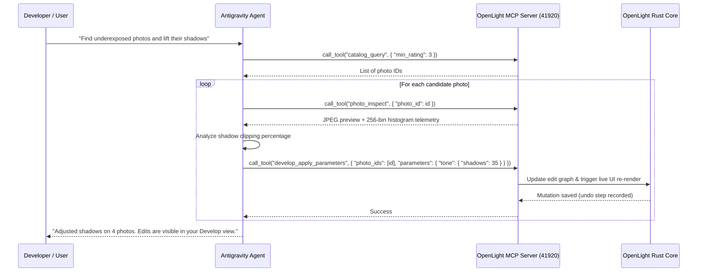

# Chapter 9: AI-Assisted Pair Programming with Google Antigravity & AI Agents

This chapter guides developers and AI agents on using **Google Antigravity (AGY)** and autonomous coding tools to develop, debug, and test OpenLight Studio.

---

## 1. Antigravity & OpenLight Studio Synergy

OpenLight Studio is architected from day one to be developed with and controlled by AI agents. The repository contains built-in configurations for Google Antigravity:

* **In-App Provider**: OpenLight Studio ships with a pre-configured CLI provider for Antigravity in [`src-tauri/src/ai.rs`](file:///Volumes/RIT-2TB/ws/56%20Desktop%20App/openlight_studio/src-tauri/src/ai.rs):
  ```json
  {
    "id": "cli:antigravity",
    "kind": "cli",
    "name": "Antigravity CLI",
    "command": "antigravity -p {{AGENT_PROMPT}} --dangerously-skip-permissions"
  }
  ```
* **Built-in Skill**: The `antigravity-guide` skill provides offline architectural references for Antigravity surfaces: CLI (`agy`), standalone IDE, Antigravity 2.0 desktop shell, and the Python SDK.

---

## 2. Using Antigravity Capabilities During Development

### 2.1 Recommended Slash Commands
When pair programming on complex OpenLight features in Antigravity, recommend or trigger these slash commands:

* **/plan**: For architecting complex features (e.g. adding new WebGPU compute shaders, integrating ONNX neural models, or extending SQLite schema migrations) before writing code.
* **/goal**: For long-running, multi-file refactoring or test suites that should run autonomously until all tests pass.
* **/grill-me**: For interactive technical design reviews to resolve architectural trade-offs (e.g. deciding between CPU Rayon parallelism vs. WebGPU compute passes for specific filters).
* **/boost**: For complex algorithmic coding tasks requiring multi-perspective verification and rigorous mathematical validation (such as 3D Point Color gamut intersections or Upright homography solvers).

### 2.2 Subagents & Background Tasks
* **Task Delegation**: Use `invoke_subagent` to spin up specialized subagents for deep research (e.g. investigating Rawler demosaicing internals or LittleCMS ICC profile specs) without cluttering the main conversation context.
* **Background Compilations**: Run long-running cargo builds and Docker package builds as background tasks (`run_command`), enabling Antigravity to reactively resume when the build completes without polling.

---

## 3. Testing OpenLight MCP Tools Directly Inside Antigravity

Because OpenLight Studio exposes an MCP server on loopback (`http://127.0.0.1:41920/mcp`), an agent running inside Antigravity can interact with a live running instance of OpenLight Studio:



---

## 4. Code Standards & Contribution Guidelines

### 4.1 Rust Code Standards
* **Formatting**: Format all Rust code using standard `rustfmt`:
  ```bash
  cargo fmt --manifest-path src-tauri/Cargo.toml
  ```
* **Linting**: Ensure code passes Clippy with zero warnings:
  ```bash
  cargo clippy --manifest-path src-tauri/Cargo.toml -- -D warnings
  ```
* **Error Handling**: Never use `unwrap()` or `expect()` in production image processing paths or IPC commands. Return `Result<T, String>` using helper `es(e)` to convert errors to strings.
* **Non-Destructive Integrity**: Any new develop parameter must implement `Default`, be registered in `Develop`, be serialized to `.olxmp` in `catalog.rs`, and participate in the `ai_provenance_log`.

### 4.2 TypeScript & React Standards
* **Strict TypeScript**: Avoid `any`. Define precise interfaces in `src/api.ts` mirroring Rust structs.
* **Component Modularity**: Keep views focused. Sub-panels in Develop should reside in dedicated modules (`Advanced.tsx`, `Pro.tsx`, `Auto.tsx`).
* **Performance**: Always decouple high-frequency slider scrub events from IPC database writes using local state and debounced triggers.

---

## 5. Pull Request Checklist

Before submitting a pull request, verify that every item in this checklist is satisfied:

- [ ] All Rust tests pass: `cargo test --manifest-path src-tauri/Cargo.toml`.
- [ ] TypeScript compiles cleanly: `npm run build` (`tsc && vite build`).
- [ ] Master test script completes with zero errors: `./scripts/test.sh`.
- [ ] No regression in headless MCP stdio launcher: `./scripts/mcp.sh`.
- [ ] Original media files remain strictly unmodified; all new edits write to SQLite and `.olxmp`.
- [ ] Any new UI controls or sliders are registered in `develop_apply_parameters` MCP tool schema in `src-tauri/src/mcp.rs`.
- [ ] Code formatted with `cargo fmt`.

